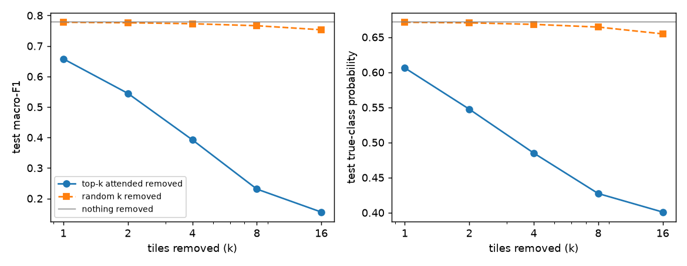
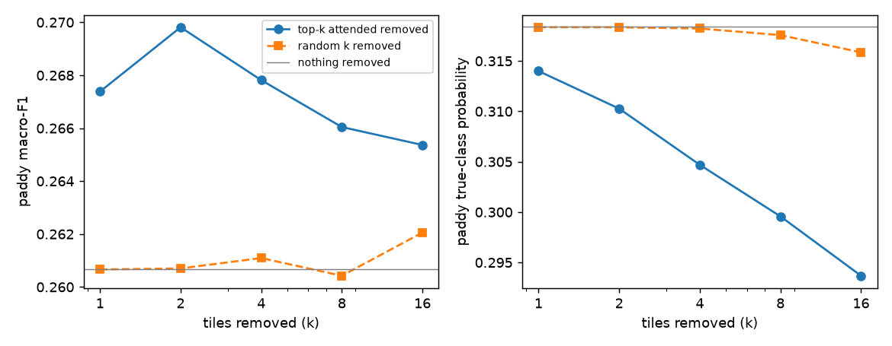

# Stage 12: does the attention head look at real symptoms?

Generated by `python -m src.explain report` from the files in `results/explain/`; nothing is typed by hand. The declaration is `runs/explain_plan.json` (declared 2026-11-20; the Paddy Doctor extension, 2026-11-21).

## Deletion test, test photos (seed-0 models)

Percentages. `gap` = true-class probability with random-k removed minus with top-k removed; ranges = 95% paired bootstrap over photos and over whole capture blocks (decision D9). Rule: top-k matters more than random-k only if both ranges are above 0 and the gap is positive in at least 4 of 5 rounds.

| k | full_macro_f1 | top_macro_f1 | random_macro_f1 | full_p_true | top_p_true | random_p_true | gap_p_true | gap_low | gap_high | gap_block_low | gap_block_high | round_wins | rounds | verdict |
|---|---|---|---|---|---|---|---|---|---|---|---|---|---|---|
| 1 | 77.9 | 65.8 | 77.8 | 67.2 | 60.6 | 67.1 | 6.5 | 5.8 | 7.3 | 4.4 | 8.5 | 5 | 5 | top-k matters more than random-k |
| 2 | 77.9 | 54.5 | 77.6 | 67.2 | 54.7 | 67.0 | 12.3 | 11.4 | 13.1 | 8.8 | 15.6 | 5 | 5 | top-k matters more than random-k |
| 4 | 77.9 | 39.2 | 77.3 | 67.2 | 48.5 | 66.8 | 18.3 | 17.4 | 19.2 | 13.1 | 23.3 | 5 | 5 | top-k matters more than random-k |
| 8 | 77.9 | 23.1 | 76.6 | 67.2 | 42.7 | 66.4 | 23.7 | 22.8 | 24.6 | 16.9 | 30.6 | 5 | 5 | top-k matters more than random-k |
| 16 | 77.9 | 15.6 | 75.3 | 67.2 | 40.1 | 65.5 | 25.4 | 24.5 | 26.2 | 18.2 | 32.8 | 5 | 5 | top-k matters more than random-k |

A big gap shows that the head's decision rests on the tiles it attends to. It does not by itself show that those tiles are symptoms (that is the human check), and healthy photos have none. Gap by true class (percentage points, per k):

| true_class | 1 | 2 | 4 | 8 | 16 |
|---|---|---|---|---|---|
| brown_spot | 12.4 | 25.6 | 42.0 | 61.1 | 67.6 |
| healthy | -8.2 | -11.5 | -13.9 | -14.6 | -12.9 |
| hispa | 11.4 | 19.2 | 31.7 | 44.6 | 48.2 |
| leaf_blast | 27.2 | 43.9 | 54.5 | 56.7 | 53.7 |

## Deletion test, val photos (seed-0 models)

Not run yet.

## Deletion test, Paddy Doctor photos at native zoom (seed-0 models)

Percentages. `gap` = true-class probability with random-k removed minus with top-k removed; ranges = 95% paired bootstrap over photos only (Paddy Doctor has no capture blocks; each photo's five round-model values are averaged first; near-duplicate photos are not grouped, so the range is narrower than it would be with groups). Rule: top-k matters more than random-k only if the photo range is above 0 and the gap is positive in at least 4 of 5 rounds.

| k | full_macro_f1 | top_macro_f1 | random_macro_f1 | full_p_true | top_p_true | random_p_true | gap_p_true | gap_low | gap_high | round_wins | rounds | verdict |
|---|---|---|---|---|---|---|---|---|---|---|---|---|
| 1 | 26.1 | 26.7 | 26.1 | 31.8 | 31.4 | 31.8 | 0.4 | 0.3 | 0.5 | 4 | 5 | top-k matters more than random-k (photo range only) |
| 2 | 26.1 | 27.0 | 26.1 | 31.8 | 31.0 | 31.8 | 0.8 | 0.7 | 0.9 | 4 | 5 | top-k matters more than random-k (photo range only) |
| 4 | 26.1 | 26.8 | 26.1 | 31.8 | 30.5 | 31.8 | 1.4 | 1.2 | 1.5 | 4 | 5 | top-k matters more than random-k (photo range only) |
| 8 | 26.1 | 26.6 | 26.0 | 31.8 | 30.0 | 31.8 | 1.8 | 1.6 | 2.0 | 4 | 5 | top-k matters more than random-k (photo range only) |
| 16 | 26.1 | 26.5 | 26.2 | 31.8 | 29.4 | 31.6 | 2.2 | 2.0 | 2.5 | 5 | 5 | top-k matters more than random-k (photo range only) |

A big gap shows that the head's decision rests on the tiles it attends to. It does not by itself show that those tiles are symptoms (that is the human check), and healthy photos have none. Gap by true class (percentage points, per k):

| true_class | 1 | 2 | 4 | 8 | 16 |
|---|---|---|---|---|---|
| brown_spot | -2.7 | -3.7 | -4.2 | -4.0 | -1.9 |
| healthy | -1.7 | -2.8 | -4.6 | -7.7 | -12.9 |
| hispa | -0.7 | -0.9 | -0.6 | 0.1 | 1.9 |
| leaf_blast | 5.3 | 8.4 | 12.2 | 16.1 | 20.1 |

## Attention on background tiles, test photos (seed-0 models)

A tile is background when more than 90% of its pixels are outside the Otsu leaf mask. `attention_per_tile_share` below 1 means background tiles get less than their share. Mask check: 8 photos have a leaf mask covering less than 2% or more than 60% of the photo (the side guess may be inverted there).

| true_class | attention_share | tile_share | attention_per_tile_share |
|---|---|---|---|
| brown_spot | 2.2 | 71.8 | 0.03 |
| healthy | 29.2 | 75.1 | 0.39 |
| hispa | 8.3 | 75.9 | 0.11 |
| leaf_blast | 2.5 | 73.9 | 0.03 |
| all | 15.3 | 74.5 | 0.21 |

## Attention on background tiles, val photos (seed-0 models)

Not run yet.

## Attention on background tiles, Paddy Doctor photos at native zoom (seed-0 models)

A tile is background when more than 90% of its pixels are outside the Otsu leaf mask. `attention_per_tile_share` below 1 means background tiles get less than their share. Mask check: 10 photos have a leaf mask covering less than 2% or more than 60% of the photo (the side guess may be inverted there).

| true_class | attention_share | tile_share | attention_per_tile_share |
|---|---|---|---|
| brown_spot | 17.6 | 20.0 | 0.88 |
| healthy | 25.7 | 22.5 | 1.14 |
| hispa | 22.7 | 22.8 | 1.0 |
| leaf_blast | 14.1 | 13.8 | 1.02 |
| all | 20.3 | 19.7 | 1.03 |

## Blind rating of the heat maps (Objective 6)

50 blind heat maps (the rule's validation examples and random extras, shown without the true class or the prediction). Raters, all disclosed: `model_rater_1` (model), `model_rater_2` (model), `model_rater_3` (model). Question: does the hot area cover visible symptoms? Percentages of ratings.

| rater | yes | partly | no |
|---|---|---|---|
| model_rater_1 | 40.0 | 30.0 | 30.0 |
| model_rater_2 | 40.0 | 30.0 | 30.0 |
| model_rater_3 | 38.0 | 36.0 | 26.0 |
| all ratings | 39.3 | 32.0 | 28.7 |

All raters gave the same answer on 88.0% of the maps; Fleiss' kappa 0.88 (three answers; 0 = chance level, 1 = perfect agreement). By example category (`extra` = random photos; `wrong` = the rule's confident mistakes), seen only after rating:

| category | yes | partly | no |
|---|---|---|---|
| correct | 52.8 | 30.6 | 16.7 |
| extra | 42.9 | 14.3 | 42.9 |
| random | 36.1 | 33.3 | 30.6 |
| wrong | 25.0 | 52.8 | 22.2 |

## Examples chosen by the rule (val predictions)

| true_class | category | rank | photo_id | round | pred_class | confidence | prob_true | item_id |
|---|---|---|---|---|---|---|---|---|
| healthy | correct | 1 | Healthy/IMG_20190419_162827.jpg | 5 | healthy | 0.95 | 0.95 | H45 |
| healthy | correct | 2 | Healthy/IMG_20190419_134856.jpg | 5 | healthy | 0.938 | 0.938 | H04 |
| healthy | correct | 3 | Healthy/IMG_20190420_193501.jpg | 2 | healthy | 0.934 | 0.934 | H31 |
| healthy | wrong | 1 | Healthy/IMG_20190424_131009.jpg | 3 | hispa | 0.992 | 0.004 | H11 |
| healthy | wrong | 2 | Healthy/IMG_20190424_131014.jpg | 3 | hispa | 0.955 | 0.036 | H17 |
| healthy | wrong | 3 | Healthy/IMG_20190420_190003.jpg | 5 | brown_spot | 0.915 | 0.055 | H13 |
| healthy | random | 1 | Healthy/IMG_20190419_170242.jpg | 2 | healthy | 0.737 | 0.737 | H43 |
| healthy | random | 2 | Healthy/IMG_20190420_194317.jpg | 2 | brown_spot | 0.506 | 0.339 | H40 |
| healthy | random | 3 | Healthy/IMG_20190424_130555.jpg | 1 | healthy | 0.832 | 0.832 | H47 |
| leaf_blast | correct | 1 | LeafBlast/IMG_4926.jpg | 1 | leaf_blast | 0.998 | 0.998 | H44 |
| leaf_blast | correct | 2 | LeafBlast/IMG_5497.jpg | 1 | leaf_blast | 0.995 | 0.995 | H50 |
| leaf_blast | correct | 3 | LeafBlast/IMG_20190419_162746.jpg | 5 | leaf_blast | 0.993 | 0.993 | H38 |
| leaf_blast | wrong | 1 | LeafBlast/IMG_20190420_194940.jpg | 2 | brown_spot | 0.952 | 0.031 | H21 |
| leaf_blast | wrong | 2 | LeafBlast/IMG_20190420_190832.jpg | 5 | brown_spot | 0.931 | 0.027 | H30 |
| leaf_blast | wrong | 3 | LeafBlast/IMG_20190419_175420.jpg | 4 | hispa | 0.927 | 0.048 | H32 |
| leaf_blast | random | 1 | LeafBlast/IMG_20190419_175210.jpg | 1 | leaf_blast | 0.941 | 0.941 | H39 |
| leaf_blast | random | 2 | LeafBlast/IMG_5484.jpg | 1 | leaf_blast | 0.343 | 0.343 | H01 |
| leaf_blast | random | 3 | LeafBlast/IMG_5524.jpg | 1 | leaf_blast | 0.925 | 0.925 | H46 |
| brown_spot | correct | 1 | BrownSpot/IMG_5511.jpg | 1 | brown_spot | 0.996 | 0.996 | H41 |
| brown_spot | correct | 2 | BrownSpot/IMG_20190420_191149.jpg | 5 | brown_spot | 0.995 | 0.995 | H27 |
| brown_spot | correct | 3 | BrownSpot/IMG_20190420_190902.jpg | 5 | brown_spot | 0.995 | 0.995 | H42 |
| brown_spot | wrong | 1 | BrownSpot/IMG_20190419_103531.jpg | 4 | hispa | 0.926 | 0.011 | H05 |
| brown_spot | wrong | 2 | BrownSpot/IMG_20190421_200151.jpg | 3 | healthy | 0.847 | 0.07 | H15 |
| brown_spot | wrong | 3 | BrownSpot/IMG_20190420_194732_1.jpg | 2 | healthy | 0.813 | 0.144 | H12 |
| brown_spot | random | 1 | BrownSpot/IMG_20190420_190157.jpg | 5 | brown_spot | 0.966 | 0.966 | H34 |
| brown_spot | random | 2 | BrownSpot/IMG_20190420_191213.jpg | 5 | brown_spot | 0.974 | 0.974 | H22 |
| brown_spot | random | 3 | BrownSpot/IMG_20190424_131056.jpg | 1 | brown_spot | 0.966 | 0.966 | H48 |
| hispa | correct | 1 | Hispa/IMG_20190419_163137.jpg | 5 | hispa | 0.996 | 0.996 | H14 |
| hispa | correct | 2 | Hispa/IMG_20190419_163135.jpg | 5 | hispa | 0.985 | 0.985 | H26 |
| hispa | correct | 3 | Hispa/IMG_20190419_140054.jpg | 3 | hispa | 0.984 | 0.984 | H37 |
| hispa | wrong | 1 | Hispa/IMG_20190424_125651.jpg | 3 | healthy | 0.902 | 0.049 | H16 |
| hispa | wrong | 2 | Hispa/IMG_20190419_102315.jpg | 5 | healthy | 0.891 | 0.063 | H36 |
| hispa | wrong | 3 | Hispa/IMG_20190419_134821.jpg | 5 | healthy | 0.882 | 0.067 | H18 |
| hispa | random | 1 | Hispa/IMG_20190419_162904.jpg | 5 | hispa | 0.598 | 0.598 | H24 |
| hispa | random | 2 | Hispa/IMG_20190420_200428.jpg | 1 | healthy | 0.695 | 0.127 | H49 |
| hispa | random | 3 | Hispa/IMG_20190424_125743.jpg | 1 | healthy | 0.754 | 0.142 | H09 |
| brown_spot | extra | 0 | BrownSpot/IMG_20190420_190143.jpg | 5 | brown_spot | – | – | H35 |
| brown_spot | extra | 0 | BrownSpot/IMG_20190420_191055.jpg | 5 | brown_spot | – | – | H02 |
| healthy | extra | 0 | Healthy/IMG_20190419_094753.jpg | 2 | healthy | – | – | H08 |
| healthy | extra | 0 | Healthy/IMG_20190420_194338.jpg | 2 | healthy | – | – | H10 |
| healthy | extra | 0 | Healthy/IMG_20190420_200430.jpg | 1 | healthy | – | – | H20 |
| healthy | extra | 0 | Healthy/IMG_20190424_125829.jpg | 1 | healthy | – | – | H28 |
| healthy | extra | 0 | Healthy/IMG_20190424_130049.jpg | 1 | healthy | – | – | H29 |
| healthy | extra | 0 | Healthy/IMG_20190424_130417.jpg | 1 | healthy | – | – | H33 |
| hispa | extra | 0 | Hispa/IMG_20190419_131106.jpg | 2 | leaf_blast | – | – | H07 |
| hispa | extra | 0 | Hispa/IMG_20190420_194355.jpg | 2 | hispa | – | – | H03 |
| leaf_blast | extra | 0 | LeafBlast/IMG_20190419_114455.jpg | 1 | leaf_blast | – | – | H23 |
| leaf_blast | extra | 0 | LeafBlast/IMG_20190419_175321.jpg | 1 | hispa | – | – | H25 |
| leaf_blast | extra | 0 | LeafBlast/IMG_20190420_195006.jpg | 2 | brown_spot | – | – | H19 |
| leaf_blast | extra | 0 | LeafBlast/IMG_5513.jpg | 1 | leaf_blast | – | – | H06 |

## Examples chosen by the rule (paddy predictions)

| true_class | category | rank | photo_id | round | pred_class | confidence | prob_true |
|---|---|---|---|---|---|---|---|
| healthy | correct | 1 | normal/PDD09894.jpg | 5 | healthy | 0.822 | 0.822 |
| healthy | correct | 2 | normal/PDD11191.jpg | 5 | healthy | 0.812 | 0.812 |
| healthy | correct | 3 | normal/PDD11575.jpg | 5 | healthy | 0.763 | 0.763 |
| healthy | wrong | 1 | normal/PDD10408.jpg | 5 | leaf_blast | 0.988 | 0.007 |
| healthy | wrong | 2 | normal/PDD10025.jpg | 5 | leaf_blast | 0.983 | 0.008 |
| healthy | wrong | 3 | normal/PDD10472.jpg | 4 | leaf_blast | 0.982 | 0.001 |
| healthy | random | 1 | normal/PDD11049.jpg | 1 | brown_spot | 0.887 | 0.022 |
| healthy | random | 2 | normal/PDD11355.jpg | 1 | brown_spot | 0.4 | 0.061 |
| healthy | random | 3 | normal/PDD11869.jpg | 1 | leaf_blast | 0.593 | 0.068 |
| leaf_blast | correct | 1 | blast/PDD04098.jpg | 3 | leaf_blast | 0.996 | 0.996 |
| leaf_blast | correct | 2 | blast/PDD02544.jpg | 3 | leaf_blast | 0.996 | 0.996 |
| leaf_blast | correct | 3 | blast/PDD02120.jpg | 3 | leaf_blast | 0.995 | 0.995 |
| leaf_blast | wrong | 1 | blast/PDD02612.jpg | 1 | brown_spot | 0.965 | 0.017 |
| leaf_blast | wrong | 2 | blast/PDD03011.jpg | 1 | brown_spot | 0.962 | 0.019 |
| leaf_blast | wrong | 3 | blast/PDD02349.jpg | 1 | brown_spot | 0.961 | 0.019 |
| leaf_blast | random | 1 | blast/PDD03339.jpg | 1 | leaf_blast | 0.796 | 0.796 |
| leaf_blast | random | 2 | blast/PDD04200.jpg | 1 | leaf_blast | 0.676 | 0.676 |
| leaf_blast | random | 3 | blast/PDD04444.jpg | 1 | brown_spot | 0.54 | 0.428 |
| brown_spot | correct | 1 | brown_spot/PDD05011.jpg | 1 | brown_spot | 0.972 | 0.972 |
| brown_spot | correct | 2 | brown_spot/PDD04889.jpg | 1 | brown_spot | 0.963 | 0.963 |
| brown_spot | correct | 3 | brown_spot/PDD05063.jpg | 1 | brown_spot | 0.962 | 0.962 |
| brown_spot | wrong | 1 | brown_spot/PDD04602.jpg | 5 | leaf_blast | 0.989 | 0.004 |
| brown_spot | wrong | 2 | brown_spot/PDD05582.jpg | 3 | leaf_blast | 0.989 | 0.006 |
| brown_spot | wrong | 3 | brown_spot/PDD05079.jpg | 3 | leaf_blast | 0.985 | 0.006 |
| brown_spot | random | 1 | brown_spot/PDD04560.jpg | 1 | brown_spot | 0.477 | 0.477 |
| brown_spot | random | 2 | brown_spot/PDD04816.jpg | 1 | brown_spot | 0.545 | 0.545 |
| brown_spot | random | 3 | brown_spot/PDD05690.jpg | 1 | leaf_blast | 0.721 | 0.213 |
| hispa | correct | 1 | hispa/PDD08504.jpg | 2 | hispa | 0.976 | 0.976 |
| hispa | correct | 2 | hispa/PDD08309.jpg | 5 | hispa | 0.967 | 0.967 |
| hispa | correct | 3 | hispa/PDD06866.jpg | 3 | hispa | 0.961 | 0.961 |
| hispa | wrong | 1 | hispa/PDD07850.jpg | 3 | leaf_blast | 0.984 | 0.009 |
| hispa | wrong | 2 | hispa/PDD07869.jpg | 5 | leaf_blast | 0.983 | 0.004 |
| hispa | wrong | 3 | hispa/PDD08056.jpg | 5 | leaf_blast | 0.981 | 0.005 |
| hispa | random | 1 | hispa/PDD07662.jpg | 1 | leaf_blast | 0.682 | 0.02 |
| hispa | random | 2 | hispa/PDD08509.jpg | 1 | brown_spot | 0.57 | 0.027 |
| hispa | random | 3 | hispa/PDD08640.jpg | 1 | leaf_blast | 0.622 | 0.151 |
