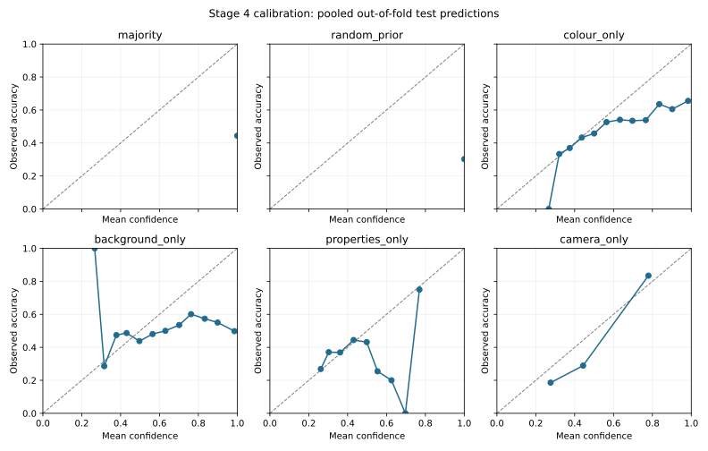

# Stage 4 sanity baselines

Built by `src/sanity_baselines.py` from `runs/stage4_*`; do not edit by hand. Scores in percent on the **test** folds of the locked split (mean ± sd, 5 rounds, and the pooled out-of-fold predictions with 95% bootstrap intervals). Nothing here is tuned, so test scores are reported directly. Chance: 25% balanced accuracy.

| baseline | test macro-F1 | test balanced acc. | test accuracy | pooled macro-F1 [95% CI] | pooled balanced acc. [95% CI] | hispa recall | ECE |
|---|---|---|---|---|---|---|---|
| majority | 15.4 ± 0.0 | 25.0 ± 0.0 | 44.4 ± 0.0 | 15.4 [15.4, 15.4] | 25.0 [25.0, 25.0] | 0.0 | 0.556 |
| random_prior | 25.2 ± 2.1 | 25.2 ± 2.1 | 30.2 ± 1.8 | 25.2 [23.7, 26.6] | 25.2 [23.7, 26.6] | 18.6 | 0.698 |
| colour_only | 52.9 ± 2.5 | 55.0 ± 2.6 | 52.8 ± 2.5 | 52.9 [51.3, 54.6] | 55.0 [53.3, 56.8] | 53.7 | 0.129 |
| background_only | 48.9 ± 1.6 | 51.8 ± 1.6 | 49.2 ± 2.0 | 49.0 [47.4, 50.6] | 51.8 [50.1, 53.6] | 47.9 | 0.136 |
| properties_only | 32.3 ± 2.8 | 36.1 ± 3.2 | 37.9 ± 2.4 | 32.5 [31.0, 33.9] | 36.1 [34.6, 37.8] | 5.7 | 0.046 |
| camera_only | 17.4 ± 1.5 | 30.9 ± 1.0 | 21.7 ± 0.8 | 17.5 [16.2, 18.9] | 30.9 [30.0, 31.8] | 100.0 | 0.092 |

Background-only and photo-properties-only results exceed chance, suggesting dataset shortcuts. Imperfect Otsu masking can leave leaf material in the background inputs. See the separate Otsu quality review.

Reliability bins and this figure are generated from saved predictions by `scripts/stage4_calibration.py`.
